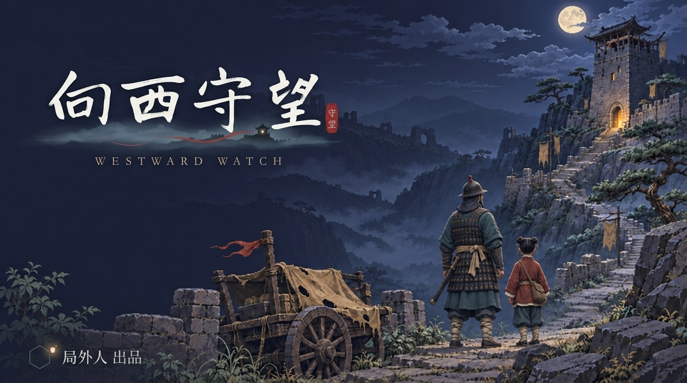

# 向西守望

明初温州宁村所遇袭。你先扮演戍卒周戍，护送八岁的妹妹小满穿过街市，在城门断后。守点结束时，周戍若还剩至少八成生命，就能背起妹妹，走过五段山道；否则由小满独自潜行，循灯去找北塔。

**[下载 v0.1.0 公开试玩版](https://github.com/hxsx1016/dora-game/releases/tag/v0.1.0)**

| 设备 | 下载与启动 |
| --- | --- |
| Windows 10/11 x64 · 键鼠 | 完整解压 `windows-x64.zip` 结尾的标准包，双击根目录的 `WestwardWatch.exe`。若 Direct3D 12 初始化失败，改用 `windows-x64-opengl.zip` 结尾的兼容包。 |
| 浏览器 · 键鼠、触屏或手柄 | 下载 `WestwardWatch-v0.1.0-web-html.zip`。完整解压后，用浏览器打开根目录的 `index.html`。 |
| Android | 手机选文件名含 `android` 的触屏 APK，横屏掌机选 `handheld-arm64` 版，可用手柄或触屏。 |
| Dora SSR | 解压 `dora-source.zip` 结尾的源码包，用 Dora SSR 打开项目并运行随包的 `init.lua`。 |

**第一次玩**，跳过或看完开机片头，在标题页选「开始游戏」，从序章「叫醒」进入故事。「操作说明」列出当前设备的按键。正式游玩会自动保存，下次在标题页选「继续游戏」读自动档；想自己留档，在暂停菜单选「存取档案」，可用三个手动槽位。标题页的「读取存档」可以选档，「选择章节」可单独试玩，正式进度另存。Windows 便携包默认把进度放在游戏目录的 `saves/`，换电脑时可一并复制。

**城外的红布车**出现在小满的独行线。城外、空村、密林和北塔使用低模 3D 场景，小满可以左右和前后移动。用键鼠时，在台面上走到车的**右柄**，对齐车辙，按住 `E` 和 `D` 向右拉到车轮落窝。拱下铁栓收起后，回左侧下石阶，按住 `Ctrl` 蹲过矮拱。

## 两条北上路

- **周戍护送**。城门前庭要守满 45 秒。兄妹同行后，背负小满穿过五段山道，用 3×3 连线慢时换弹，从三项本领中择一，在工台用沿途材料改制火铳。倒下后可以「重整再赴」，从护送第一段再出发。
- **小满独行**。数到二十后迈步出城，穿过空村和森林。在低拱前蹲伏，用桌下或草丛藏身，也能投瓶制造声响，引开拾荒者。两条路在北塔各有结局，双通关后可探索后院深井。

详细操作见[各平台键位](docs/掌机与KTR赛道适配说明.md)，剧情与场景设定见[剧本](docs/向西守望-剧情与剧本.md)和[明朝美术设定](docs/守望-明朝全局美术设定.md)。

局外人团队使用 Dora SSR 与 TypeScript 制作，参加 2026 开源游戏开发大赛。代码采用 Apache-2.0，随包字体采用 SIL OFL 1.1。[代码许可](LICENSE) · [AI 使用与素材声明](docs/AI使用与素材声明.md) · [开发与提交指南](CONTRIBUTING.md)
