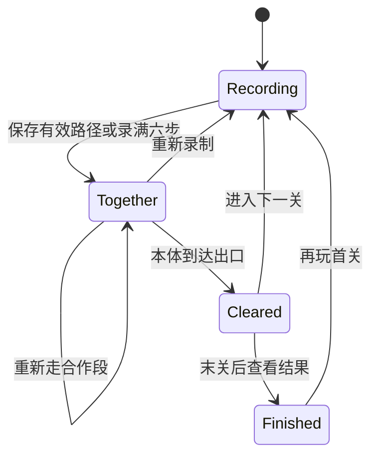

# 《借我六步》单人十日开发执行计划

> 历史原型计划，已撤回。当前十天交付目标为「守望」双线枪战与解谜游戏。以下排期仅供追溯旧原型。当前项目依据见同目录 `PROJECT_OVERVIEW.md` 页首。

第 10 天交付《借我六步》1.0。默认成品是桌面键盘游戏的离线 ZIP。玩家完整解压后用目标浏览器打开 `index.html`，从首屏提示学会录制，连续打完两关，看到结局，可以再玩或关掉页面。若 2026 年 11 月 22 日开工，按连续十个自然日计算，交付日为 2026 年 12 月 1 日。

本文沿用上一轮的候选玩法。玩家先录下最多六步，再和回声逐拍合作穿门。以 macOS 上的 Dora SSR、TypeScript → Lua、桌面键盘、单机内存状态为排期依据。每天按 5 个净开发小时估算，其中 4 小时有明确任务，1 小时留给故障、返工和重复验证。十天合计 40 小时任务、10 小时缓冲。可用小时缩水时直接按第六节减量。

实现时先打开同目录的《代码实现逻辑.md》，其中有可执行的 TypeScript 回合规则和控制器分发流程。《回合与关卡验收.md》给出三张地图的逐拍预期，《回合验收向量.csv》提供 34 组回归输入。

### 1.0 成品验收

| 玩家操作 | 必须在交付件上观察到的结果 |
| --- | --- |
| 在一台没有项目源码和 Dora 开发环境的目标电脑上完整解压 ZIP，断开网络，打开 `index.html` | 游戏标题、中文提示、棋盘和可用按键完整显示；实际测试过的系统和浏览器版本写入说明 |
| 只看屏上提示完成首关，再尝试第二关 | 能理解录制与合作的区别，能主动等待。撞门时得到原因，重走和重录都有入口 |
| 从首关玩到末关，经历一次错误路线 | 可从错误路线自救。末关展示结束文案，例如“最后一扇门打开了。六步走完，回声留在门那边。” |
| 在结束页再玩，然后关闭页面重新打开 | 两次均回到首关空路径。可见退出方法为关闭游戏页 |
| 从留存的最终文件再次校验 | ZIP 附一页启动与按键说明，记录版本、大小和 SHA-256。校验值与通过整局测试的那份文件相同 |

默认验证环境为开发机和另一台带桌面浏览器的电脑。目标浏览器以 D1 的文件方式实测结果为准。导出依据为本机 Dora 教程 `Doc/zh-Hans/Tutorial/lua/game-app-pack.md` 中的“从 Web IDE 导出可玩的 Web 游戏”。若 D1 的离线导出在目标浏览器受阻，先查完整解压、导出模式和运行时资源。用当日缓冲测试备选的 Server 版 HTML 在已有静态站上的玩家入口，只有明确接受联网交付且链接通过异机测试才变更交付形态。

## 一、交付边界与开发顺序

| 优先级 | 玩家最终能做什么 | 开发完成的判据 |
| --- | --- | --- |
| 必做 | 打开游戏就进入首关，分辨本体、回声、踏板、门和出口 | 标准窗口与最小支持窗口下都有完整棋盘、阶段和当前可用按键 |
| 必做 | 移动、等待、录制、合作、重走合作段、重新录制 | 同一组输入每次得到同一局面。空录制、越界、撞墙、撞门均有可辨别反馈 |
| 必做 | 打完“停在板上”和“按时换板”两关，到结束页后再玩 | 两份标准解在 Dora 运行时成立。无解的录制可以立刻重录，重试与再玩均清除旧会话影响 |
| 必做 | 在开发环境之外打开成品 | 解压离线 HTML 版 ZIP，用桌面浏览器打开后能完成整局 |
| 有余量 | 第三关“再开同一组门”、短移动动画、可选音效 | 分别可以单独关闭。第三关通过标准解和反例，静音下仍能读懂棋盘 |

**关键依赖**依次为目标引擎加载入口及子模块 → 单步规则 → 首关完整输入与画面 → 重置及关卡切换 → 双关回归 → 干净副本启动。同一个人按这个顺序开发。地图和输入约定已在配套规格中确定，可以直接作测试数据。首轮资源使用图形与系统现有字体。新增联网、存档、编辑器、美术管线或第二输入平台时单独估工，不占用这条关键路径。

## 二、工程分工与数据契约

以下路径以 `dora-game/` 为根，是拟建文件。只在首次承担具体职责时建立对应文件。

| 拟建位置 | 拥有的数据与职责 | 调用约定 | 第一项验收 |
| --- | --- | --- | --- |
| `init.ts` | 创建单一应用控制器，挂载棋盘和 HUD，处理退出清理 | 持有一次输入订阅和一个活动房间。装配完成立即载入首关 | 从真实 `init.lua` 启动，显示正确关号和起点 |
| `Script/game/levels.ts` | 原始地图、顺序、关名、每关首次提示 | 把字符网格校验成只读关卡定义，错误定位到关号、行、列 | 正常地图均能读入，坏字符、缺起点或门组缺板能精准报错 |
| `Script/game/turn.ts` | 阶段、位置、路径、回放进度和通关判定 | 新关工厂产生初态。一次操作返回新状态、接受或拒绝的原因、一次性事件。可脱离 Dora 节点调用 | 同一初态重复执行相同指令，状态摘要相同 |
| `Script/game/session.ts` | 当前关号、活动会话序号、输入放行、过关至下一关或结束页 | 控制器是规则状态的唯一写入者。每次消费一个命令，先保存规则结果，再通知画面 | 过关按键连发只切一次。重录能立即覆盖正在播放的旧动作 |
| `Script/view/board.ts` | 静态格子、机关、角色、脚印和坐标换算 | 输入关卡、只读局面和事件。新关重建静态层，每拍更新有变化的格与角色 | 关动画、改窗口大小或重新挂载后，同一状态画出同一棋盘 |
| `Script/view/hud.ts` | 关名、阶段、步数、下一落点说明、阻挡原因、结果页 | 提示文字从命令映射和规则结果取得。完成页发送“继续”，由控制器决定去向 | 显示哪一个按键能解开当前困境。静音、同格、末拍停驻皆可辨 |
| 开发用回归入口 | 保存输入串、逐拍摘要与预期结果，用编译后的同一规则执行 | 与正式 `init.ts` 分开选择运行。失败显示关号、输入序号、预期与实际 | 单次运行得到首个分歧，正式版本启动时直接进入游戏 |

**数据流。** 键盘按下 → 转成一个玩家命令 → 控制器检查阶段和输入锁 → 规则试算并提交一拍 → 画面读取快照 → 用事件播放临时提示。动画结束只解除显示层输入锁；开门、移动与过关都已在规则提交时确定。关卡配置与录制路径分开存放，重走保留路径，重录创建空路径。模块间直接调用即可。

**调试记录。** 每行记录关号、会话序号、输入序号、命令、是否接受、阶段、主体格、有效拍数、回声格、录制序列、可见门组和拒绝原因。只在开发模式输出。若画面显示“门开着却被挡住”，先对比输入前的门、该拍预测通行条件和输入后的门，再定位规则问题或渲染问题。

## 三、Dora 接入与界面约定

1. **启动探针。** 在项目入口导入 `Script/game/` 下的可识别常量。先编译，再在可切换预览时运行，核对入口标记与日志。编辑器能解析导入只算编译前检查。若交接中占用引擎的另一个项目仍在使用，先做地图与纯规则，利用可用窗口完成运行验证。以实际生成路径制作运行文件清单。
2. **类型与坐标。** 用该安装版本生成的 Dora 类型声明确认键盘、窗口、字体和清理接口。地图左上为 `(0,0)`，向下增加行号。逻辑只存整数格。棋盘渲染把行号反向转换为 Dora 向上的坐标，角色、脚印和门共用这一个换算。用第三关右上角的出口检验上下方向。
3. **输入。** 方向键移动，空格等待，回车确认录制或继续，`R` 重走合作段，`T` 重录。按下边沿只发一次命令，抬起才重新武装。多键按实际到达顺序处理。插值期间丢弃普通步进输入，重走和重录允许立即中断。窗口失焦清空按下集合并取消进行中的插值，返回时直接显示已提交局面，以一次新的按下继续。
4. **画面。** 上方固定显示关号、阶段和本阶段下一步。中间的棋盘使用等边格，底部显示相关操作。按可用宽高取较小格宽后居中。先按 960×540 和 640×360 两种逻辑尺寸验收，宽屏居中。玩家用实心轮廓，回声用空心轮廓，同格时显示外环。A、B 用符号与纹理区分。关门画横杠，开门留缺口；门在角色脚下关闭时保留角色前景。
5. **帧与资源。** 一拍由一次接受的命令触发。静止时世界不会随帧更新。若加入插值，目标时长约 100 毫秒并保留瞬移开关。重置、过关或失焦时由控制器清锁并重绘，旧动画完成时核对会话和动画序号。字体与标签创建失败写明资源名，冷启动冒烟检查文字确实可见。音效资源缺失时保留视觉反馈。
6. **构建记录。** 使用本机 Dora 可执行文件的绝对路径，显式传入项目根。D1 记录源码、生成的 `init.lua`、各模块实际加载位置和去缓存重建步骤。D8 用干净目录验证清单。涉及仓库的实现阶段按已有 `AGENTS.md` 执行，区分源码、要求跟踪的生成文件、缓存和已有工作区改动。

## 四、逐日工作单

每天的时间块按单人串行排列，含当日验收，各合计四小时。第五小时属于当日缓冲。下面的“通过”均指能在指定环境重演，不能用已写完文件替代。

### D1 · 把工程风险留在第一天

- **0.5 h** 核对当前工作区、引擎运行目标与项目根。记录本地修改归属、构建命令和项目的启动入口。
- **1 h** 打通多文件探针。改一次子模块标记并重建，确认日志显示新标记，排除运行到旧 Lua 或另一项目。
- **1.5 h** 在探针中加入中文标题和方向键可移动的方块。用 Web IDE 的“导出 HTML”生成首包，完整解压，断网打开 `index.html`。记录浏览器版本、字体表现、一次按键产生的移动次数，安排第二台设备供 D8 复验。
- **1 h** 录入两张地图，接入参考实现中的读取、校验与摘要。用等宽图、错误字符和缺起点各验一次。
- **通过** 留下一个已在目标浏览器打开过的探针包和一份首关初态。若当天导出失败，用 D2 首段时间处理发布路径，冻结第三关与插值的工时给交付修复。

### D2 · 做出可重演的一拍

- **1 h** 完成录制的移动、等待、碰撞、手动确认和第六拍自动确认。输出逐步路径，特别检查连续等待储存了两个相同落点。
- **1.5 h** 完成合作拍的试算、门判定、提交和拒绝。有效拍从零起算，回放游标停在末步，之后世界仍能继续走。
- **0.75 h** 完成重走、重录、出口和单次通关事件。记录重置前后路径是否保留。
- **0.75 h** 在开发回归入口执行两关标准解，以及空录制、撞门、站在关闭的门上等待四类边界。固定可重放输入串。
- **通过** 第一关两种录制有不同结果。第二关完成时本体在出口，回声停 B 板，总有效合作拍为 4。任一拒绝操作的前后规则摘要相同。

### D3 · 交付可从头玩的第一关

- **1 h** 接入真实键盘并处理按住、抬起、失焦恢复。先用瞬移画面减少定位变量。
- **1.5 h** 绘制地图、门、两角色、脚印编号和下一落点，完成状态到 HUD 的映射。
- **0.75 h** 接上阶段切换、重走、重录和过关页，覆盖错误录制后自救。
- **0.75 h** 重新导出首关包，请一位没看过设计的人打开，只凭屏幕提示尝试首关。用错解、重录、标准解和两种窗口尺寸补测，记下第一个需要解释的按键或局面。
- **通过** 玩家只用屏上显示的键，就能从开局走到首关结算。若晚于此门槛，立刻使用静态角色与文字反馈，第三关退出承诺范围。

### D4 · 让第二关要求真正的时序配合

- **0.75 h** 接入第二关的双门组，验证 A/B 符号、位置和机关配对。关卡只提供数据。
- **1 h** 实现下一拍落点预览和当前门状态的区分。HUD 文字示例为“下一拍回声踩 A”，以免玩家把预测状态误当成当前门状态。
- **1 h** 逐拍复演正确路线、回声过早离板、玩家晚到一拍三种情况。验证碰闭门后世界停在原拍，等待才推进。
- **1.25 h** 接上第一关进入第二关，快速重录并重试十次，检查单次按键对应一次动作。修第一个规则或输入分歧。
- **通过** 第二关能用标准解通关。只录“左、左”时，重走合作段也无解，重新录制后能过。用这个反例验证两关并非同一个谜题。

### D5 · 闭合完整游戏流程

- **1 h** 接上末关、结束页、再玩，按启用的关卡列表决定末关。再次游玩应进入首关空录制状态。
- **1 h** 检查“第六步自动切换时持续按键”“按住回车穿过结算”“重置撞上旧回调”三处边界。
- **1 h** 在小窗调整字符、脚印叠加和同格轮廓。重复落点显示最后一个编号，并在 HUD 显示按顺序排列的全部六个槽位。
- **1 h** 导出双关包，跑两轮完整游戏，途中插入一次错误路线和一次重录，确认第二轮初态一致。保留该 ZIP 作为可恢复版本。
- **通过** 在浏览器里从游戏首屏到结束文案、再玩、关闭页面后重新打开均已走通。若未通过，D6 优先修这条流程。

### D6 · 让一次失败能被玩家解释

- **1 h** 首关按阶段显示简短指令。录制时突出“回车保存”，合作时突出下一落点，卡在闭门前显示“这拍回声没踩 A。R 重走，T 重录”。对同一拒绝只更新一处提示。
- **1 h** 做门与对应板的同步反馈，站在关闭门格上、两人重叠、回声停驻三种局面在静态画面都可读。
- **1 h** 在双关门槛已通过时加入一次移动插值并做中断处理，否则用这段时间修 D5。单拍中多个状态变化一起提交，避免先后回调各推一拍。
- **1 h** 在静音、最小支持窗口、失焦返回三种情况下完整过关。记录任何误解发生前的最后一个动作，优先调整提示的时刻。
- **通过** 任取第二关一拍，能在画面上分别指出本体所在格、回声下一格、现在开的门和能用的重试方式。

### D7 · 决定关卡数量并冻结内容

- **0.5 h** 从冷启动跑双关冒烟。存在启动、输入、状态或重开错误时，把后面的第三关工时直接转去修错。
- **1.5 h** 达标时录入第三关，按既有“一板控制同组门格”数据实现复用。以连续经过 A、B、A 三道门作为验收。
- **1 h** 对所有启用的关卡逐个执行标准解和指定无解录制。若有旁路，先改关卡数据再复测。
- **1 h** 锁定关卡列表和操作映射；从首关走到结束页，复核去掉可选关也能正确结束。
- **通过** 得到确定的双关或三关版本。第三关在 1.5 小时内要求改回合规则时，保留双关版本。

### D8 · 做出第一份可直接交付的发行候选包

- **1 h** 导出离线 HTML 版 ZIP，保留入口、`html-assets` 与随附文件，写一页启动与操作说明，按构建标识命名。
- **1 h** 把该 ZIP 拷到第二台目标电脑，离线解压并用目标浏览器打开。验证中文、键盘焦点、全部关卡和结局，再打开一次。记录系统、浏览器和 ZIP 指纹。
- **1 h** 验证两种窗口尺寸、重开十次、窗体失焦、退出并再启动。核对关键提示和结束页均可见。
- **1 h** 修当日首个运行阻断并从全新副本复测，记下构建标识和实际运行路径。
- **通过** 独立设备上的玩家只凭该包和操作说明即可完成整局并再玩。保留这份已通过的发行候选，D9 和 D10 随时可回退到它。

### D9 · 按严重度做回归

- **1.5 h** 跑配套规格的规则和关卡用例，特别重跑拒绝回滚、门下等待、回声走完后的移动与重复结算。
- **1 h** 跑连续十次重试、连续两轮通关、插值途中重置、切换焦点。检查每次真实按键的命令数与重开前后活动根节点数。
- **1 h** 先修能阻断开局、通关、重试的问题，再修稳定复现的提示错误。每个修复留下最短输入序列。
- **0.5 h** 重新构建候选版本，把修复用例和标准解一起复跑。若修复造成新阻断，恢复最近通过版本后缩小改动。
- **通过** 启用内容不存在已知的启动失败、无法通关、无法重开或一次输入推进多拍的问题。

### D10 · 交付 1.0 成品

- **1 h** 取最近一次通过冷启动及整局验证的候选 ZIP，核对构建标识和 SHA-256，在新的目标目录完整解压。
- **1 h** 游戏全程走一遍，插入一次故意失败、一次重录和结束后再玩。第二次进入首关时比对初态摘要。
- **1 h** 复验最后修过的模块及其相邻流程。遇到启动或通关阻断时优先取已实测通过的前一候选，按该包重新走查成品标准。
- **1 h** 将通过验收的版本化 ZIP 和操作说明放进最终交付目录，记录实际文件大小、指纹、测试环境、关卡列表和剩余表现问题。
- **通过** 用交付目录里的 ZIP 在目标设备复现冷启动、全部关卡、结局和再玩。保存玩家可取得的文件以及对应的源码版本记录。

## 五、定位与验收纪律

| 现象 | 首先核对 | 处理及复验 |
| --- | --- | --- |
| 编译成功，运行仍见旧图或找不到模块 | 项目根、根入口、导入路径、实际 Lua 位置及标记 | 从独立副本重新构建，改一个可见标记验证整条链 |
| 第一次过门成功，重试同样输入却失败 | 路径是否被共用并改写，回放进度与有效拍是否清零 | 比较首次与重试的第零拍摘要和第一处分歧 |
| 门提示开着却被挡 | 当前画面门组与下一拍预测门组是否混用 | 复演第二关错误录制 `LL` 和标准 `WLL`，逐拍比对 |
| 连按或切回窗口多走一步 | 采样层重复、前一房间的订阅残留、失焦按键状态 | 查看一次按下产生命令数，先修输入入口，再回归第六步自动确认 |
| 规则日志正确但角色位置错 | 行列反转、窗口缩放、旧动画完成事件 | 关闭插值直接画状态。若正确，再单独验证重置与缩放 |
| 超过工时 | 对比最近门槛与可运行版本，而非统计文件数 | 依次取消第三关、音效、插值，保留静态反馈与规则回归 |

**缺陷记录格式。** 写下运行标识、关号、录制串、合作串、第一次出错的按键、预期与实际。能用这六项复现再修。坏资源或脚本异常须记录启动位置及最早报错。阻断问题当日处理；装饰差异留到下一门槛已通过之后。

## 六、投入变化时怎样收缩

| 实际总净工时 | 承诺范围 | 时间优先分配（含验证） |
| --- | --- | --- |
| 约 50 h | 双关完整游戏，第三关以 D7 门槛决定 | 上述十日计划，40 h 已分配，10 h 留给不确定性 |
| 约 30 h | 双关，静态切格、基础 HUD 与重试 | 工程 3 h，规则及回归 6 h，键盘与画面 5 h，双关串联 4 h，冷启动与回归 6 h，缓冲 6 h |
| 约 20 h | 触发工时预警，沿用提供的两张地图和规则核心，保留双关、结局与发行包，使用静态棋盘 | 导出探针 2 h，规则接入与验证 4 h，键盘与静态画面 4 h，双关及结局 3 h，离线包与回归 3 h，缓冲 4 h。D3 首关若未打通，显式重新估算双关交付风险 |

若平台从桌面改为触控，最先改变的是输入与布局。先在真实目标设备完成“移动、等待、确认、重录、重走、继续”六类动作，再决定保留几关。若玩法更换，重新估算规则、预览和关卡三块，D3 首个可玩闭环与 D8 干净启动仍可作工期检查点。

## 七、DeepSeek 4.1 Flash 的规划复核输入

开发者可以把“当前关卡图、一次录制、合作输入、预期与实际状态、当日剩余时间”交给指导模型。D2 请它逐拍定位首次分歧，D4 请它试找绕过双机关的路径，D7 请它指出能在剩余工时完成的最小修复。让它返回触发输入、出错前状态、期望状态和对应验收用例。每个意见回到同一编译产物复演后再进入修改清单。

## 八、实现时放在手边的联调卡

### 1. 首次启动到第一次再玩的屏幕内容

| 时刻 | 画面要传达的事实 | 实际显示的主提示 | 玩家用什么动作验证 |
| --- | --- | --- | --- |
| 第一关零步 | 此刻在录脚印，左侧有块 A 板 | “方向键走一步。试试左边的踏板。” | 按左后本体落在 a，第一槽出现左箭头 |
| 踩板后 | 录制路径已含一步，本次允许结束录制 | “回车保存脚印，和回声一起走。” | 按回车，两者出现在起点，板上的 ① 保留 |
| 合作零拍 | 现在方向键移动本体，回声会走向 ① | “你走一步，回声也走一步。” | 向右后看到本体和回声分开移动，A 门打开 |
| 录制用尽 | 回声停在末格，本体仍可行动 | “回声会留在这里。” | 本体继续过门，回声外环与板同时可见 |
| 撞上将关闭的门 | 本次被挡的原因是回声下一落点 | “下一拍回声会离开 A。” 底栏保留重走和重录两种操作 | 本次输入后，门状态、回声格和步号都与被挡前一致 |
| 需要换一条路线 | 玩家可以用两种粒度重来 | 底栏保持“R 重走本段　T 重录脚印” | 按 R 后仍有脚印，按 T 后脚印清空 |
| 中间关完成 | 本关已经结算，下一关尚未开始 | “通过。回车进入下一关。” | 新的一次回车进入下一关的录制零步 |
| 最后一次通关 | 可以结束本局并重新体验首关 | 末关显示“回车查看结果”，结束页显示“回车再玩” | 两次独立按下依次到结束页、首关。首关显示自己的第一条提示 |

首关已提示录制方向，第二关把信息收敛为“一块板对应一组门。空格可以留下一拍等待。”随后由玩家决定把等待录在哪里。后续普通成功移动保留画面空间，让门的形状和步号承担反馈。只有碰撞、阶段变化或首次出现的新操作占用主提示行。

### 2. 向下实现与向上联调的次序

1. 拿 `T12` 单独调用规则。最后一个右移必须得到 `closed_A`，有效拍仍为 1。若这里失败，只查回声预测、门组计算和整拍回滚。
2. 让控制器依次消费相同命令，比较每次提交后的状态。若第一步正常、重试后出错，核对路径复用和房间会话序号。
3. 将 `T12` 的最后快照直接交给视图。当前 A 应开，下一脚印应在 b。若图中 B 已开，视图错误地用了候选拍。
4. 用物理按键重新输入 `T12`。把“收到的键、控制器投递的命令、规则接受的拍数”分三栏比较。例如连按两次右方向，控制器收到两个 R，规则只接受一个。这样能把闭门拒绝与漏接键盘区分开。
5. 用 `T19`、`T20` 依次测重走和通关，再将输入换成上一关的继续事件。通过后进入跨关整局验证。

### 3. 本机引擎接线与复位表

本机安装包的中文 `Dora.d.ts` 已核对到 `onKeyDown`、`onKeyUp`、`onKeyPressed`、`onAppEvent`、`onAppChange`、`onCleanup`。`onAppEvent` 的类型包含 `WindowFocusLost` 和 `WindowFocusGained`，`onAppChange` 的类型包含 `Size`。D1 与 D3 分别验证实际收到的事件和次序。

| 接入点 | 负责人要做的事 | 在场景中怎样看出接对了 |
| --- | --- | --- |
| `onKeyDown`、`onKeyUp` | 同一应用输入节点归集按键。每次按下记录物理键，映射和投递一次，抬起解除。阶段切换仍保留尚未抬起的物理键 | 一次长按跨越第六步，日志只有一条步进命令 |
| `onAppEvent` | 丢失焦点时清按下集合，停止输入，立即把角色放回快照位置。恢复焦点后处理新的按下边沿 | 窗口外松键，返回后下次移动恰好一格 |
| `onAppChange` | 收到尺寸变动后用当前可绘制区域重算棋盘与 HUD 布局，共用同一格中心换算 | 连续缩放时同一角色、脚印和门仍落在同一格 |
| `onCleanup` | 在节点销毁时释放该节点持有的订阅和临时效果引用。切房仅销毁旧房间节点，输入归应用根所有 | 连续十次重试，活动房间根数为一，投递命令数保持稳定 |

**复位时哪些东西跨边界保留。** 自动确认保留六个落点、关号与物理按下集合。重走保留地图和路径，回放进度、提示和插值回零。重录只保留地图与关号，创建空路径。下一关按列表换图，清空路径与本关提示。再玩从列表第一项重新装载。窗口缩放只更新位置和字号，失焦按已提交的局面恢复画面。

### 4. D1 可以照着执行的构建检查

在项目根的终端把 `DORA_BIN` 设为 `/Users/tqym_16/Applications/Dora.app/Contents/MacOS/Dora`，把 `GAME_ROOT` 设为本项目 `dora-game` 的绝对路径。所有命令显式指定项目。以下阶段在有对应输入文件时执行。

| 次序 | 操作 | 保存的结果 |
| --- | --- | --- |
| 1 | `"$DORA_BIN" cli status -p "$GAME_ROOT"` | 项目路径、引擎版本、当前预览目标 |
| 2 | 缺类型声明时执行 `"$DORA_BIN" cli ts install -p "$GAME_ROOT" -l zh-Hans` | 能在目标项目中定位到 `Dora.d.ts` |
| 3 | 入口引用子模块后执行 `"$DORA_BIN" cli build -p "$GAME_ROOT"` | 编译退出状态、实际入口与子模块 Lua 产物路径 |
| 4 | 可切换预览时执行 `"$DORA_BIN" cli run -p "$GAME_ROOT"` | 项目唯一标记、首关地图编号与起点坐标 |
| 5 | `"$DORA_BIN" cli log -n 40` | 含唯一标记的日志。把标记改一次后重复构建运行，确认路径和产物都正确 |
| 6 | Web IDE 选择项目文件夹并执行“导出 HTML”，完整解压生成的 ZIP | 断网用桌面浏览器打开 `index.html`，看到同一个标记、中文文字和方块，按方向键确认有响应 |

D1 的运行记录写清引擎从哪个目录加载模块。D8 在另一目录按同一记录重演。一个常见分歧是源码存在、编辑器可跳转，但运行目录缺少加载所需的 Lua 文件。查看运行时实际加载路径，比重复修改 TypeScript 导入语句更快定位。
