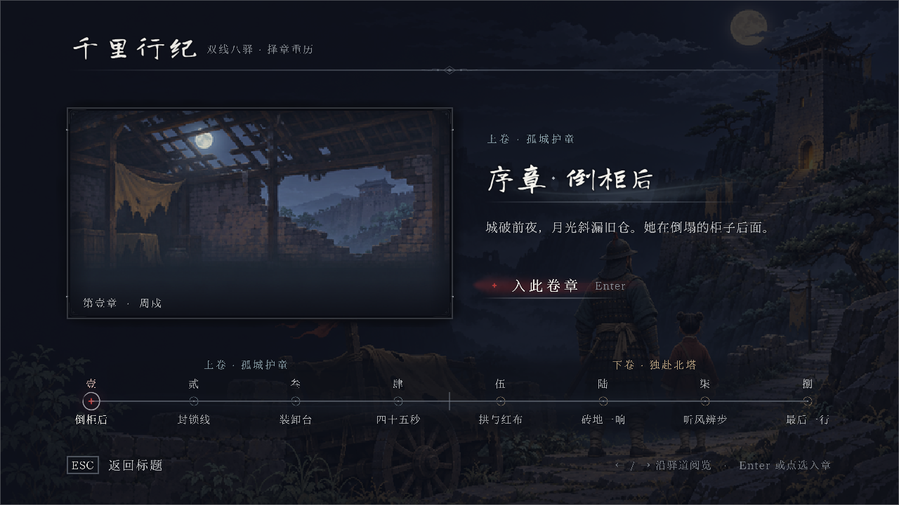
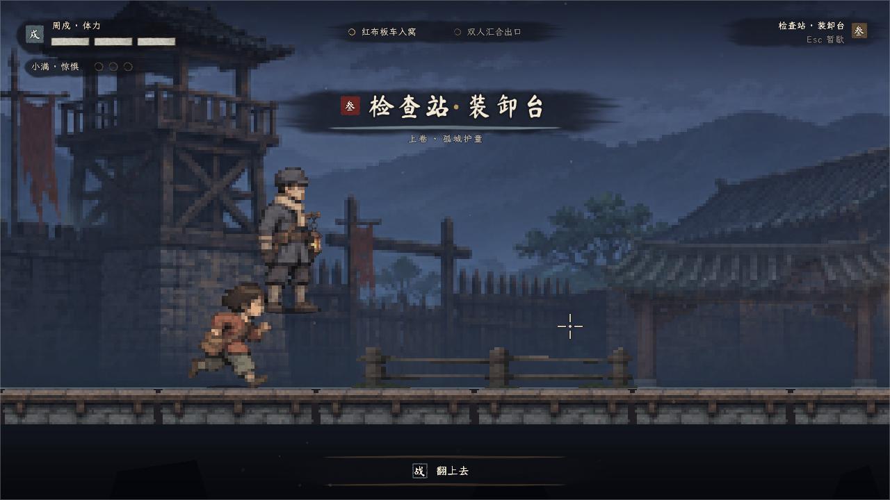
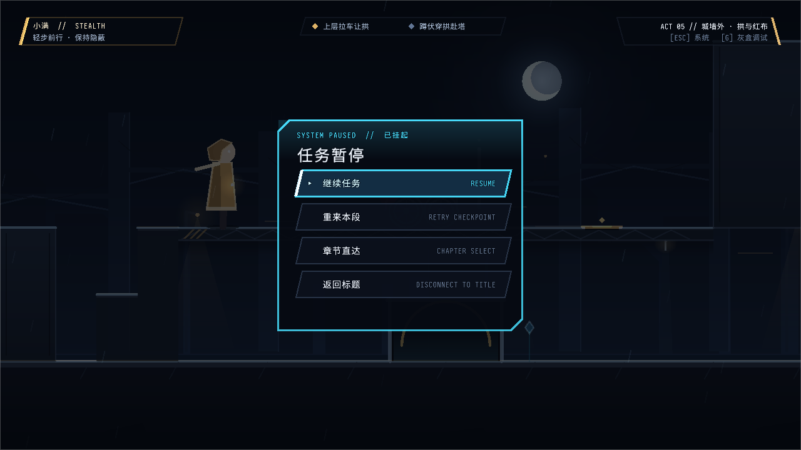

# 《向西守望》策划案

| 项目 | 内容 |
| --- | --- |
| 文档版本 | v1.0 · 整合试玩版 |
| 更新日期 | 2026-11-24 |
| 对应代码 | `feature/watch-integrated` 当前 HEAD |
| 验证基线 | Dora SSR 1.10.2.5，Windows x64 OpenGL |
| 文档定位 | 当前可玩版本的设计基线；旧 D1/D2 文档保留为技术档案 |

> **一句话**：城破那天，一个士兵把一个孩子送出了城门；现在，她要一个人走到北方的塔。

## 一页摘要

- **类型**：双线叙事动作游戏。前半段是 2.5D 侧视枪战与护送，后半段是 2D 潜行平台。
- **平台与输入**：Windows x64 离线包，键鼠操作，目标 16:9。
- **体验时长**：设计目标 25—30 分钟，真人首通时间待测。
- **当前内容**：八个房间全部可进入；像素场景与角色、水墨标题/HUD/菜单、明代角色动作已整合。
- **当前边界**：街道与检查站敌兵仍是靶标；音频、持久化存档、正式平衡和 Windows 冷启动尚未完成。
- **验证**：TypeScript 构建通过；D6—D9 共 93 条玩法断言通过；整合回归 22 条通过；八房间局内与暂停界面均可渲染。

---

## 1. 产品定位

《向西守望》不是纯枪战，也不是纯潜行。它用两段相反的操作体验讲同一件事：**保护一个人，和一个人独自活下去**。

| 项目 | 设计 |
| --- | --- |
| 类型 | 双线叙事 · 2.5D 侧视枪战 + 2D 潜行平台 |
| 核心动词 | 护送、挡枪、推拉、投瓶、蹲行、敲门 |
| 叙事基调 | 明末沿海，城破之夜；克制、安静、物件叙事 |
| 情绪曲线 | 护送的压力 → 断后的决绝 → 独行的紧张 → 抵达的安静 |
| 引擎 | Dora SSR + TypeScript |
| 交付形态 | Windows x64 离线便携包 |
| 团队规模 | 5 人 |
| 开发周期 | 10 天 |
| 当前阶段 | 八房间整合试玩版可运行；真人通关与 Windows 冷启动待验收 |

### 体验承诺

1. **前半段用身体保护**：周戍的掩体、火力和站位就是小满的安全空间，不靠养成数值。
2. **后半段用声音和视线生存**：小满没有血条和武器，只有蹲伏、慢走、投瓶和路线选择。
3. **结尾用物件收束**：指南针、纸条和登记簿空行，比直接对白更重。

---

## 2. 世界观与叙事

### 2.1 背景

明代沿海，倭寇袭城。城破前夜，守军士兵周戍在废墟里找到八岁的小满，把指南针和一张纸条塞进针套交给她。第二天，他护送她穿过街道、检查站和城门；在城门最后一战，他留下断后，把她送出城。

小满在城外等他，数到一百，没有人来。她独自穿过城墙外、废弃村庄和北塔森林，最终抵达北塔，把指南针和纸条交给守卫。守卫在登记簿最后一页写下她的名字，并留下一行空白。

### 2.2 角色

| 角色 | 定位 | 关键特征 |
| --- | --- | --- |
| 周戍 | 军人线主角 | 火铳、掩体、翻滚/翻越；寡言，用动作保护 |
| 小满 | 孩子线主角 / 护送对象 | 八岁；恐惧时会蹲下捂耳；会跟随、躲藏、投瓶、敲门 |
| 倭寇枪兵 | 军人线敌人 | 街道/检查站靶标，城门四批守点敌人；城门会举枪预警、开火、被击倒 |
| 拾荒者 | 孩子线敌人 | 村口巡逻；听见瓶声会转头、调查、追逐 |
| 猎犬 | 孩子线敌人 | 森林巡逻；听见脚步会转耳、追赶、嗅闻 |
| 北塔守卫 | 尾声角色 | 提灯开门，接过针套与纸条，翻开登记簿 |

### 2.3 双线结构

| 段落 | 内容 | 目标时长 |
| --- | --- | --- |
| 序章 | 城破前夜，周戍在废墟里找到小满，给她指南针 | 1 分钟 |
| 军人线 | 街道、检查站、城门断后 | 12—15 分钟 |
| 切换 | 小满在城外等他，数到一百，没人来 | 约 30 秒 |
| 孩子线 | 城墙外、废弃村庄、北塔森林 | 10—12 分钟 |
| 尾声 | 她到达北塔，交出指南针和纸条 | 1 分钟 |

### 2.4 叙事母题

- **指南针**：方向、承诺和“往北走”的具体指令。
- **纸条**：周戍没能说出口的话，最后变成登记簿上的一行记录。
- **红布板车**：军人线是障碍和掩体，孩子线是必须自己拉动的重量。
- **北塔的灯**：孩子线始终可见的远方目标。
- **登记簿空行**：留给下一位守望者，也留给玩家。

---

## 3. 核心体验与设计支柱

### 支柱一：保护是空间，不是数值

军人线的安全感来自站位：站在小满和枪口之间、贴住街垒、把她送到门洞。小满不会死亡，但会因恐惧停步；玩家必须靠近、安抚、再带她走。

**设计落点**：掩体三态、恐惧三格、安抚 60 拍、双人出口。

### 支柱二：两条线互为回声

军人的指令变成孩子的生存本能：周戍教她“敲两下”，她在塔门敲两下；周戍推过的红布板车，她在城外自己拉动；周戍留下的指南针，最后交到守卫手里。

**设计落点**：同一套“敲两下”交互、同一辆板车、同一件针套。

### 支柱三：少对白，多物件

不靠长对白解释关系。用指南针、纸条、铁盔、铅丸、红布、北塔的灯和登记簿推进叙事。UI 只保留当前目标、状态和可用动作。

**设计落点**：水墨旁白带、章名横幅、城门中文大写计数、北塔登记簿。

### 支柱四：失败快，重开快

城门倒地回到绞盘，按一次 E 重新守点；孩子线被抓后 1 秒回到安全点。设计目标是检查点密集、失败成本低；当前先保证城门失败和孩子线被抓的快速复位。

**设计落点**：城门 `gate-idle` 待确认、村口/森林 `caught` 复位、`R` 重试。

### 支柱五：小体量，可交付

10 天只做一条街、一座塔、三种敌人。所有系统复用同一套输入、镜头、交互、检查点和房间数据。

**设计落点**：八房间数据驱动；敌人 AI 用固定巡逻点 + 触发器，不做寻路和 NavMesh。

---

## 4. 游戏流程

### 4.1 玩家循环

```text
标题页
  ├─ 开始游戏 → 序章 → 街道 → 检查站 → 城门 → 城墙外 → 村庄 → 森林 → 北塔 → 片尾
  ├─ 选择章节 → 八个房间任选（当前全部解锁，便于试玩）
  └─ 操作说明 → 返回标题

局内
  ├─ 推进 → 触发剧情/交互 → 切房
  ├─ Esc → 暂停（继续 / 重试检查点 / 选择章节 / 返回标题）
  ├─ R → 从最近检查点重试
  └─ 失败 → 城门回绞盘 / 潜行被抓回安全点
```

### 4.2 八章流程

| 章节 | 房间 key | 视角 | 核心动词 | 主要节拍 |
| --- | --- | --- | --- | --- |
| 壹 · 序章·倒柜后 | `prologue` | 周戍 | 接近、递物 | 走到柜后 46 单位内按 E；60 拍递针套；她起身跟随；两人到门口 |
| 贰 · 街道·封锁线 | `street` | 周戍 + 小满 | 瞄准、射击、护送 | 两名敌兵在 340/560；带小满到 900/860 进检查站 |
| 叁 · 检查站·装卸台 | `checkpoint` | 周戍 + 小满 | 推车、安抚、双人出口 | 车 640→768；恐惧满 3 格则安抚 60 拍；车落窝且两人在 792—928 才开门 |
| 肆 · 城门·四十五秒 | `gate` | 周戍 → 小满 | 守点、挡枪、送别 | 绞盘 118 / 门洞 960；守 2700 拍；四批敌兵；门边 E 送别；数到一百后按 D |
| 伍 · 城墙外·拱与红布 | `outside` | 小满 | 拉车、下阶、蹲拱 | 右柄 E+D 拉车 128 单位；下石阶；蹲过 44 高拱；沿墙根到村庄 |
| 陆 · 废弃村庄·砖地一响 | `village` | 小满 | 拾瓶、投瓶、钻桌 | 瓶架 112 拾瓶；按住 F 瞄准松手；引开拾荒者；钻过桌下 304—416；过 440 |
| 柒 · 北塔森林·听风辨步 | `forest` | 小满 | 蹲行、绕狗、抓时机 | 狗巡逻 620—780；草后等；蹲行或拉开距离；林缘 1450 进塔 |
| 捌 · 北塔·最后一行 | `tower` | 小满 | 敲门、交物、看登记簿 | 门前 445 按 E 敲两下；36 拍开门；60/120/180 拍递物、空行、片尾；E 再玩 |

---

## 5. 核心系统

### 5.1 护送与恐惧

小满不会死亡。她的状态由“跟随、找掩体、躲藏、冻结、安抚”五个状态组成。

| 状态 | 触发 | 行为 | 退出 |
| --- | --- | --- | --- |
| `follow` | 默认 | 跟在周戍身后约 30 单位；撞到矮台会自己跳 | 听到危险 → `seekCover`；恐惧满 → `frozen` |
| `seekCover` | 恐惧 +1、未满三格 | 跑向房间安全锚 | 到达安全点 → `sheltered` |
| `sheltered` | 到达安全锚 | 蹲下捂耳 90 拍 | 计时结束 → `follow` |
| `frozen` | 恐惧满 3 格 | 原地蹲下，不再跟随 | 周戍靠近 ≤64 按 E → `calming` |
| `calming` | 冻结时按 E | 周戍蹲下安抚；第 12/36 拍两次敲击，第 36 拍恐惧降到 1 | 第 60 拍 → `follow` |

- **恐惧上限**：3 格。
- **安抚距离**：64 世界单位。
- **安抚节拍**：第 12 拍第一声、第 36 拍第二声、第 60 拍恢复。
- **动作占用**：安抚 0—59 拍期间，周戍不能移动、射击、推车或通用敲击；同一只 E 不会被车把抢走。
- **当前实现差异**：护送段的恐惧目前由周戍开火结算触发，按最近敌人位置与“小满是否暴露”判定；街道与检查站敌兵暂不还击。若设计上要求“敌人开火吓到她”，需要把危险源改到敌兵开火，并按敌人分配危险 ID。详见第 10 节。

### 5.2 枪战与掩体

- **体力**：周戍 3 格；只有城门守点敌人会开火造成伤害。
- **瞄准/射击**：鼠标移动准星，左键发射火铳；射线命中最近的敌人，被实体挡住则打空。
- **掩体三态**：
  - `coverNear`：范围内有可贴实体，不按 Shift 也为真。
  - `coverHug`：贴靠姿势成立（`coverNear` + 按住 Shift）。HUD 和姿态只读它。
  - `coverBlocking`：实体位于本次来向上，只说明位置对，不保证挡下。
  - **成功挡下只认 `coverBlocked` 事件**；当拍体力不变。
- **敌人预警**：城门敌兵举枪 36 拍后开火；冷却 150 拍；射程 760。
- **城门四批**：守点第 0 / 9 / 15 / 25 秒出场；第一批第一枪约在第 127 拍。
- **当前实现差异**：街道与检查站敌兵是静态靶标，不还击；城门敌兵才完整走“预警—开火—掩体结算”。这是当前整合版的真实边界，不是最终设计。

### 5.3 板车与双手占用

| 场景 | 操作 | 距离 | 结果 |
| --- | --- | --- | --- |
| 检查站 | 周戍站左柄，按住 E + D 向右推 | 段内车轴 640→768（世界 1280→1408），共 128 单位 | 车轮落窝，双人出口条件之一 |
| 城墙外 | 小满站右柄，按住 E + D 向右拉 | 车轴 304→432，共 128 单位 | 让出下层拱洞，可下阶穿拱 |

- **速度**：64 单位/秒。
- **双手占用**：`gripping=true` 时不能射击、翻滚、翻越、投瓶或通用敲击；A/D 只给车。
- **同拍优先级**：同一拍按 E + 左键/空格时，有效的车把 E 优先，先握柄，不射击、不翻滚。
- **当前实现差异**：只移动当前操控角色；另一人由跟随 AI 自行跟上，尚未实现“双人分别握住左右柄、同步推车”的计划项。

### 5.4 投瓶与潜行

**投瓶**

1. 走到瓶架 112 附近，按 E 拾瓶。
2. 按住 F 瞄准；准星落点会取该处地面，显示预览。
3. 松手投出；按住不足 0.12 秒视为误触，保留瓶子。
4. 飞行固定 0.62 秒（37 拍），触地时只发一次 `bottleLanded`，并结算拾荒者是否听见。
5. 落点可选右侧砖地 608 或左侧软土 272；不同落点会把拾荒者引向不同方向。

**拾荒者**

- 巡逻 464—512，速度 40。
- 听觉半径 480；听见后转头 18 拍，走向落点，停留 120 拍，再返回巡逻。
- 调查中看见小满（非蹲、距离 <240、垂直差 <40）累计 24 拍后转为追逐，速度 96。
- 小满蹲下或钻入桌下可切断视线；追逐中隐藏 60 拍后回到巡逻。
- 碰到小满即被抓，1 秒后回到房间起点 140；已拿到的瓶子保留。

**猎犬**

- 巡逻 620—780，速度 56。
- 小满未蹲且移动、距离 <300 时，狗转耳 18 拍，然后以 78.4 速度追赶。
- 追上即被抓；蹲下或拉开距离后，狗停在原地嗅闻 60 拍再返回。
- **当前实现差异**：狗的听觉只看“是否蹲下”和“是否移动”，按住 Shift 慢走仍会被听见；若希望慢走成为有效潜行手段，需要增加噪声阈值或噪声累积。

### 5.5 城门守点与交权

- **就位**：小满走到门洞 960；周戍站到绞盘 118（身体边缘贴住绞盘）。两人就位自动开始。
- **守点**：2700 拍 = 45 秒，只累计可操作的模拟步；暂停不推进。
- **敌兵**：四批，分别在 0 / 9 / 15 / 25 秒出场；举枪 36 拍，冷却 150 拍。
- **倒地**：体力归零当拍清空敌兵、计时归零、回到绞盘；必须松开 E 后重新按 E 才再次开始。
- **送别**：守满后到门边 860 按 E；控制权交给小满，周戍留在门内。
- **数到一百**：关门后 1440 拍（24 秒）才接受“新按下 D”；若提前按住 D 不放，没有上升沿，必须先松开再按。
- **出城**：小满走到 1020 切到城墙外。

### 5.6 检查点、失败与重试

| 场景 | 失败/重试 | 当前行为 |
| --- | --- | --- |
| 城门 | 体力归零 | 回绞盘 118，体力回满，敌兵清空，按 E 重新就位 |
| 村庄 / 森林 | 被拾荒者或狗抓住 | 1 秒后回房间起点 140；敌人回位；已拿瓶子保留 |
| 任意局内 | `R` | 从最近检查点重开；无检查点时从房间起点重开 |
| 暂停菜单 | “重试检查点” | 与 `R` 相同 |
| 片尾 | E / R | 回序章重新开始 |

- **检查点标记**：街道入口 900、城外洞后 380、森林林缘 1450。
- **持久化**：当前没有磁盘存档；检查点只在本次运行内有效。关闭游戏或返回标题后不会保留进度。

### 5.7 固定步长与事件

- 模拟固定 60 拍/秒；渲染帧可能补跑 0—5 步。
- 伤害、恐惧、贴靠挡下、投瓶触地、房间切换只在模拟步结算。
- 前端每帧通过 `drainEvents()` 取一次事件队列；切房时旧队列交给新实例，旧房 `knock` 不迁移。
- 这让表现层可以按队列顺序播放，而不用自己判断“这一拍发生了什么”。

---

## 6. 操作

### 6.1 局内

| 操作 | 周戍（军人线） | 小满（孩子线） |
| --- | --- | --- |
| 移动 | A/D 或 ←/→ | A/D 或 ←/→ |
| 瞄准/攻击 | 鼠标瞄准，左键发射火铳 | 持瓶时按住 F 瞄准，松手投出 |
| 跳跃 | 空格跳跃/翻滚；贴矮台时翻越 | 空格跳跃 |
| 掩体/慢走 | 按住 Shift 贴住柜台、街垒 | 按住 Shift 轻步慢走 |
| 蹲伏 | — | 按住 S 或 Ctrl 蹲下；低拱下自动保持蹲姿 |
| 互动 | E 递物/安抚/敲击；按住 E + D 推车 | E 拾瓶/敲门/拉车；按住 E + D 拉车 |
| 暂停 | Esc | Esc |
| 重试 | R | R |

### 6.2 菜单

- W/S 或 ↑/↓ 选择；A/D 或 ←/→ 在章节格间移动。
- Enter / 空格确认。
- Esc 返回。
- 鼠标移动到可见按钮上会切换选中；左键点击确认。

### 6.3 开发快捷键

| 按键 | 作用 |
| --- | --- |
| 1—8 | 直接进入对应房间 |
| Tab | 下一房间 |
| F1 | 回到前端试玩 |
| F2 | 切到灰盒调试视图 |
| G | 在前端与灰盒之间切换 |

开发快捷键不属于正式玩家操作说明。

---

## 7. 关卡设计

### 7.1 序章 · 倒柜后

- **目的**：教会移动、E 交互、跟随，建立“递出指南针”的核心物件。
- **节拍**：周戍从 80 出发；小满蹲在 300 的倒柜后；进入 46 单位内按 E；第 12 拍针套递过去、第 36 拍纸条塞好、第 60 拍她起身；两人到 660/620 进街道。
- **失败**：无战斗；可自由重试。
- **当前状态**：完整可玩。

### 7.2 街道 · 封锁线

- **目的**：教会鼠标瞄准、左键射击、翻越矮台和护送。
- **节拍**：敌兵在 340 和 560；街心柜台 300—400、高 44；小满跟随；两人到 900/860 进检查站。
- **当前状态**：可玩。敌兵是静态靶标，不清敌也能走到出口；如果正式版要保留“清场才放行”，需要在 `stepStreet` 增加 `aliveEnemies()===0` 门禁。

### 7.3 检查站 · 装卸台

- **目的**：把护送、恐惧、安抚和板车组合成第一个真正的协作关卡。
- **节拍**：候检区队栏、柜台、两名靶标敌兵（段内 430/505）；红布板车段内 640→768（世界 1280→1408）；小满恐惧满 3 格会冻结，需靠近按 E 安抚 60 拍；车落窝且两人在段内 792—928，出口才开。
- **失败**：敌兵不还击；主要失败是恐惧停步和车未落窝。
- **当前状态**：完整可玩；双人出口、板车落窝和安抚流程已验证。

### 7.4 城门 · 四十五秒

- **目的**：军人线的高潮；用掩体和火力守住 45 秒，然后把孩子送出去。
- **节拍**：小满自动走向门洞 960；周戍到绞盘 118；守点开始；四批敌兵；贴街垒 520 挡枪；守满到门边 860 按 E；关门；小满数到一百；松开再按 D 迈步；走到 1020 出城。
- **失败**：体力归零回绞盘，按 E 重新守；同一拍倒地的 E 不会自动重开。
- **当前状态**：完整可玩；失败、重开、守满、送别、数数、交权均已回放验证。

### 7.5 城墙外 · 拱与红布

- **目的**：让孩子线第一次独立使用“拉车”和“蹲行”。
- **节拍**：小满在上层 160/96；右柄 E+D 把车从 304 拉到 432；沿台面回左端下石阶；按住 Ctrl 蹲过 280—360、净高 44 的拱；洞后检查点 380；沿墙根石阶和塔灯走到 1200，进村庄。
- **失败**：无敌人；掉下台面可重新爬台阶。
- **当前状态**：完整可玩；拉车、拱洞、检查点恢复已验证。

### 7.6 废弃村庄 · 砖地一响

- **目的**：用声音引开敌人，用桌下空间完成第一次真正的潜行通过。
- **节拍**：瓶架 112 拾瓶；按住 F 瞄准；松手投向右砖地 608 或左软土 272；拾荒者 464—512 巡逻，听见后转头、走过去、停留；小满按住 Ctrl 钻过 304—416 的桌下；过 440 通行线；到 640 进森林。
- **失败**：被看见 24 拍后追逐，碰到即被抓，回 140；瓶子保留。
- **当前状态**：完整可玩；投瓶落点、拾荒者调查、追逐、钻桌、通行线均已回放验证。

### 7.7 北塔森林 · 听风辨步

- **目的**：把潜行从“单一敌人”扩展到“巡逻犬 + 草丛 + 矮台 + 时机”。
- **节拍**：狗在 620—780 巡逻；小满从 120 出发；草丛 300—380、700—790、1150—1240；矮台 520—640、980—1100；蹲下或拉开距离躲狗；林缘 1450 进塔。
- **失败**：被狗追上即被抓，回 140；狗回巡逻起点。
- **当前状态**：完整可玩。慢走仍会被狗听见，实际解法以蹲行为主；这是当前实现的已知差异。

### 7.8 北塔 · 最后一行

- **目的**：把“敲两下”的暗号、指南针和纸条收束成结尾。
- **节拍**：小满在门廊 418；走到 445 按 E；当拍第一声、第 12 拍第二声；第 36 拍门开；第 60 拍递针套和纸条；第 120 拍登记簿最后一页与空行；第 180 拍片尾；E/R 回序章。
- **当前状态**：完整可玩；水墨登记簿卡片、章名横幅和片尾已接入。

---

## 8. 界面与美术

### 8.1 界面流

| 界面 | 内容 | 操作 |
| --- | --- | --- |
| 标题页 | 竖排书法「向西守望」、明月、北塔、周戍与小满、红布板车 | 开始游戏 / 选择章节 / 操作说明 |
| 选择章节 | 上卷「孤城护童」四章、下卷「独赴北塔」四章；八张房间画笺与汉字章印 | 方向键/鼠标选择，Enter/左键进入，Esc 返回 |
| 操作说明 | 周戍与小满双页卷谱、键帽与说明 | Esc/Enter 返回 |
| 暂停 | 竖长卷轴「暂歇」；继续、重试检查点、选择章节、返回标题 | 方向键/鼠标，Enter 确认，Esc 继续 |
| 局内 HUD | 左上体力/恐惧；顶部目标；右上章名与 Esc；底部情境提示；准星 | 自动 |
| 叙事层 | 底部墨韵旁白带、章节横幅、城门中文大写计数、北塔登记簿 | 自动/交互推进 |
| 失败/重试 | 中弹闪白、被抓提示、回安全点 | 自动，1 秒复位 |

### 8.2 视觉方向

- **场景与角色**：像素美术，明代沿海城邦；八张房间背景、角色图集、板车/瓶子/门/灯/桌/绞盘等道具。
- **界面**：水墨与宣纸质感；飞白笔刷、墨晕、卷轴木轴、朱砂方印、腰圆引首章、枯笔墨环。
- **配色**：冷青/月光用于周戍与军人线，暖琥珀用于小满与孩子线，绯红用于敌意、危险和城门；宣纸底色保证文字可读。
- **字体**：霞鹜文楷用于正文与 HUD，马善政毛笔楷书用于标题、章名、篆印和中文大写数字；均为 SIL Open Font License。
- **可读性**：不依赖音频也能分辨“举枪预警 / 掩体挡下 / 受击 / 被抓”；体力格用实心/空心，恐惧用墨点/空环，危险用朱砂而非只靠色相。
- **分辨率**：UI 以 1280×720 为基准缩放；像素场景保持最近邻；目标 16:9，其他宽高比由镜头适配，需实机验收。

### 8.3 当前画面








### 8.4 音频

**当前版本尚未接入音频。** 设计上需要，但不在当前构建内：

- 火铳发射、弹道打空/命中、掩体挡下、受击。
- 敲木板/敲塔门/安抚的两声“咚、咚”。
- 板车木轮落窝、瓶子起飞/触地、玻璃碎裂。
- 猎犬转耳/追赶/嗅闻；拾荒者脚步与翻找。
- 城门四批敌兵、门轴、关门、数数时的环境声。
- 标题与片尾的环境音乐。

音频接入时优先保证“静音可读”仍然成立，不把关键信息只放在声音里。

---

## 9. 内容节奏与时长

| 段落 | 目标时长 | 节奏作用 |
| --- | --- | --- |
| 序章 | 1 分钟 | 建立关系与核心物件 |
| 街道 | 3—4 分钟 | 第一次交火与护送教学 |
| 检查站 | 4—5 分钟 | 护送、恐惧、板车三系统合流 |
| 城门 | 4—5 分钟 | 军人线高潮与情绪转折 |
| 城墙外 | 3—4 分钟 | 孩子线教学：拉车、下阶、蹲拱 |
| 村庄 | 3—4 分钟 | 声音引敌与桌下潜行 |
| 森林 | 3—4 分钟 | 巡逻犬与时机判断 |
| 北塔 | 1—2 分钟 | 收束、登记簿、片尾 |
| **合计** | **25—30 分钟** | 设计目标；真人首通时间待测 |

节奏原则：

- 每个房间只引入一个新动词，不在同一段塞入两个新系统。
- 军人线用“更大的声音和更近的子弹”推高压力；孩子线用“更安静的环境和更近的脚步”推高压力。
- 城门是唯一的长时间守点；村庄和森林不重复守点。
- 片尾不追加战斗，给玩家时间看完登记簿。

---

## 10. 当前实现边界

### 10.1 已具备

- 八个房间的完整流程与切房。
- 周戍的移动、瞄准、射击、掩体、翻滚/翻越、推车、安抚。
- 小满的跟随、恐惧、躲藏、蹲行、拉车、投瓶、敲门。
- 城门 45 秒守点、四批敌兵、倒地重开、送别、数数、交权。
- 村庄拾荒者与森林猎犬的巡逻、听觉/视觉、追逐、被抓复位。
- 水墨标题、章节选择、操作说明、暂停、HUD、旁白、章名横幅、城门计数、北塔登记簿。
- 像素场景/角色/道具、明代角色动作、两套开源中文字体、UI 图集。
- 高清镜头与 `worldMapper`：点射和投瓶共用屏幕→世界换算。
- 固定 60 拍模拟、事件队列、切房事件迁移、旧房敲击过滤。

### 10.2 部分完成 / 已知差异

| 项目 | 当前实现 | 建议 |
| --- | --- | --- |
| 街道/检查站敌兵 | 静态靶标，不还击；检查站恐惧由周戍开火触发 | 若正式版需要“被火力压制”，给这两段敌兵加预警/开火；或明确它们是教学靶 |
| 街道出口 | 只判两人到 900/860，不清敌也能过 | 若要保留“清场才放行”，补 `aliveEnemies()===0` 门禁 |
| 森林慢走 | 狗只对蹲伏免疫；Shift 慢走仍会被听见 | 增加噪声阈值/累积，让慢走有潜行价值 |
| 双人握柄 | 只移动当前操控角色，另一人由跟随 AI 跟上 | 实现左右柄分别抓握与同步推车 |
| 城门数数 | 1440 拍（24 秒）后可迈步 | 与“30 秒切换段”的文档口径对齐，或明确 24 秒是操作窗口 |
| 检查点密度 | 街道 900、城外 380、森林 1450；村庄被抓回 140 | 视真人试玩结果决定是否加村中检查点 |
| 存档 | 无持久化；关闭游戏丢失进度 | 正式版至少保存当前章节/检查点 |
| 音频 | 未接入 | 按第 8.4 节优先级接入 |
| 手柄/设置 | 未接入 | 键鼠交付可接受；音量/全屏/分辨率设置待补 |
| 平衡 | 未做真人完整计时与难度调优 | 先跑完整通关，再调恐惧、敌兵和检查点 |

### 10.3 验证记录

| 项目 | 结果 |
| --- | --- |
| TypeScript 构建 | 26 个源文件全部 built |
| 玩法断言 D6 | 21/21 |
| 玩法断言 D7 | 32/32 |
| 玩法断言 D8 | 13/13 |
| 玩法断言 D9 | 27/27 |
| 整合回归 | 22/22（菜单键鼠、高清点射/投瓶、90 个素材帧、事件队列、八房间渲染） |
| 城门回放 | 失败一局第 499 拍倒地；成功一局 2700 拍守满、送别、数数、出门 |
| 八房整链 | 序章→街道→检查站→城门→城外→村庄→森林→塔门→再玩，全段走通 |
| 仓库检查 | 通过：源码与 Lua 配对、Markdown 链接、忽略项检查 |
| 真人键鼠通关 | 待测 |
| Windows x64 冷启动 | 待测 |

---

## 11. 下一阶段

### P0 · 可交付性

1. 从默认入口用真实键鼠完整通关一次，记录卡点、时长和失败次数。
2. 在 Windows x64 解压包中冷启动，检查中文、分辨率、窗口缩放、暂停/恢复、切房和资源显示。
3. 修复通关中发现的阻断问题；补发行记录、ZIP 校验值和实测环境。

### P1 · 设计一致性

1. 决定街道/检查站敌兵是否还击；若还击，接入城门同款预警/开火/掩体结算。
2. 给街道出口加“清场”门禁，或明确它是可绕过的教学段。
3. 给森林慢走加噪声阈值，让 Shift 慢走成为有效手段。
4. 实现双人握柄同步推车，兑现“两个人一起把车推入窝”的设计承诺。
5. 统一“数到一百”的操作窗口与文档口径。

### P2 · 表现与打磨

1. 音频接入：火铳、敲击、板车、瓶子、狗、城门、环境。
2. 存档/设置：章节与检查点保存、音量、全屏/分辨率。
3. 平衡：恐惧增长、敌兵数量与射程、检查点密度、城门波次。
4. 片尾与标题的最终美术/字幕校对；中文标点和字体覆盖检查。

---

## 附录 A · 当前调参

| 参数 | 当前值 |
| --- | --- |
| 模拟步长 | 60 拍/秒 |
| 世界单位 | 1 单位 ≈ 1.84 cm |
| 小满身高 / 蹲高 | 64 / 36 |
| 周戍身高 | 88 |
| 周戍体力 | 3 |
| 小满恐惧上限 | 3 |
| 安抚距离 / 总拍数 | 64 / 60 |
| 板车速度 | 64 单位/秒 |
| 板车距离（检查站/城外） | 128 / 128 |
| 投瓶飞行 | 0.62 秒 = 37 拍 |
| 投瓶蓄力阈值 | 0.12 秒 |
| 拾荒者听觉半径 | 480 |
| 猎犬听觉半径 | 300 |
| 城门守点 | 2700 拍 = 45 秒 |
| 城门波次 | 0 / 540 / 900 / 1500 拍 |
| 敌兵预警 / 冷却 | 36 / 150 拍 |
| 敌兵射程 | 760 |
| 城门数数操作窗口 | 1440 拍 = 24 秒 |

## 附录 B · 房间锚点

| 房间 | 范围 | 关键锚点 |
| --- | --- | --- |
| 序章 | 0—720 | 小满 300；门口 660/620 |
| 街道 | 0—1000 | 敌兵 340/560；出口 900/860 |
| 检查站 | 0—1000（世界偏移 640） | 车 640→768；出口 792—928；绞盘前的柜台 240—340 |
| 城门 | 0—1200 | 绞盘 118；门洞 960；门边 860；出城 1020 |
| 城墙外 | 0—1240 | 车 304→432；拱 280—360；检查点 380；墙根尽头 1200 |
| 村庄 | 0—720 | 瓶 112；桌下 304—416；拾荒者 464—512；砖地 608；通行线 440 |
| 森林 | 0—1600 | 狗 620—780；草丛 300—380 / 700—790 / 1150—1240；林缘 1450 |
| 北塔 | 0—720 | 门 445；门廊 400—490 |

> 检查站使用段内坐标：世界坐标 = 段内坐标 + 640。例如车轴段内 640/768 对应世界 1280/1408，出口段内 792—928 对应世界 1432—1568。

## 附录 C · 代码与验证入口

| 内容 | 文件 |
| --- | --- |
| 房间数据 | [rooms.ts](../Script/watch/rooms.ts) |
| 玩法模拟 | [play.ts](../Script/watch/play.ts) |
| 护送与恐惧 | [escort.ts](../Script/watch/escort.ts) |
| 输入 | [input.ts](../Script/watch/input.ts) |
| 入口与切房 | [app.ts](../Script/watch/app.ts) |
| 水墨主题 | [theme.ts](../Script/watch/fe/theme.ts) |
| 菜单 | [menus.ts](../Script/watch/fe/ui/menus.ts) |
| HUD | [hud.ts](../Script/watch/fe/ui/hud.ts) |
| 玩法断言 | [verify-d6.lua](../tools/verify-d6.lua) · [verify-d7.lua](../tools/verify-d7.lua) · [verify-d8.lua](../tools/verify-d8.lua) · [verify-d9.lua](../tools/verify-d9.lua) |
| 整合回归 | [verify-integration.lua](../tools/verify-integration.lua) |
| 八房回放 | [replay-d5.lua](../tools/replay-d5.lua) |
| 城门回放 | [replay-gate.lua](../tools/replay-gate.lua) |
| 打包说明 | [windows-pack-README.md](../tools/windows-pack-README.md) |

> 旧文档说明：`守望-玩法交付-2026-11-23.md` 记录的是 2026-11-23 的玩法交付过程，其中“worldMapper 待集成”等状态已被当前整合版取代；`守望-前端需求.md` 是前端联调需求，不是当前状态表。两者与本文冲突时，以当前代码和本策划案为准。
